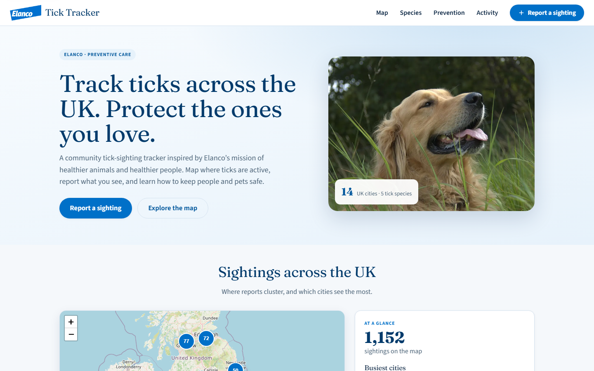
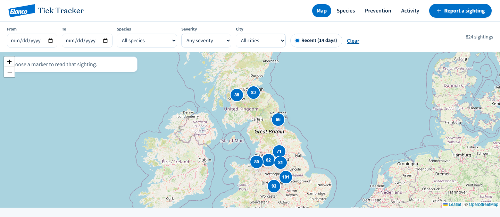
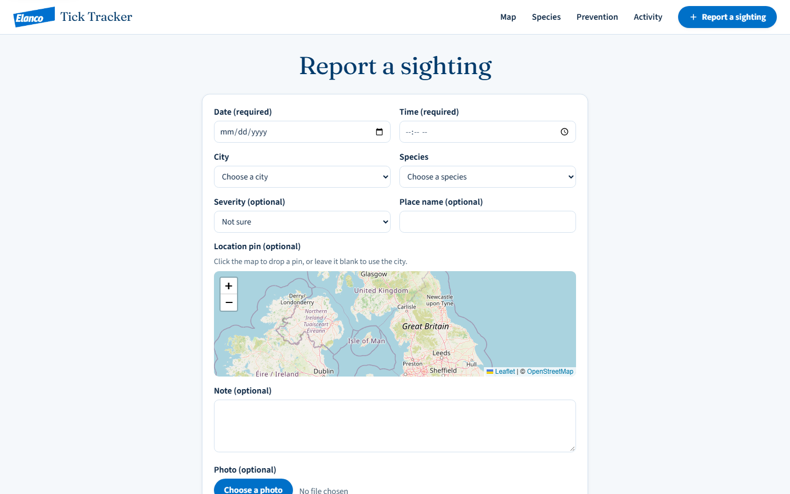
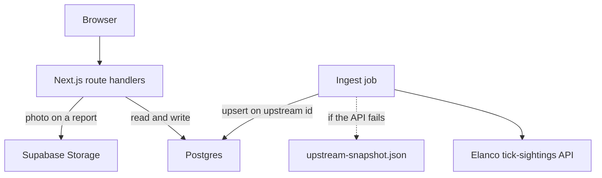

# Tick Tracker

A UK tick-sighting map, reporting form, and short guides. Built by **Anass Nadeem** for the Elanco Placement Program technical task.

**Live app:** [https://tick-tracker-elanco.vercel.app](https://tick-tracker-elanco.vercel.app)

This is a placement project. It is not an official Elanco product, and nothing in it is veterinary or medical advice.

The submission write-up is [docs/technical-documentation.md](docs/technical-documentation.md). The walkthrough script is [docs/video-script.md](docs/video-script.md).

## Screenshots



The home page: report a sighting, or open the map.



The map. Imported sightings have no coordinates, so each cluster sits on a city centre. Shape and letter are the species. Zooming splits a cluster into markers.



The report form. Date, time, city, and species are required. Severity, a place name, a map pin, a note, and a photo are optional.

## What it does

- Maps the Elanco task dataset, plus a local extension for 2025 and 2026, plus any report you submit.
- Filters by date, species, severity, city, and the latest 14 days of data.
- Opens a sighting panel with the record, recent activity in that city, and actions to report, get directions, or share.
- Accepts a new sighting with client and server validation. A missing severity or photo warns you and still saves.
- Explains the five species in the dataset, lists prevention steps, and charts sightings by month, city, and year.

## How the data works

The browser never calls the Elanco API. A separate ingest step loads the feed into Postgres. Pages and the map read that database, so a dead upstream API does not take the site down.

| Source | What it is | Coordinates | Severity |
| --- | --- | --- | --- |
| `upstream` | 1,000 records from `GET https://dev-task.elancoapps.com/data/tick-sightings` (2012–2024). Each row is an id, a timestamp, one of 14 cities, a species, and a latin name. | None. The map uses the city-centre point stored on the city. | Set on ingest from that species' risk level in the guide. The feed itself has no severity. |
| `extended` | 150 local rows so 2025 and 2026 are not empty. 2026 stops at 30 October. Counts follow the same summer peak as the imported years. Ids are prefixed `local-`. | Same as imported rows: city centre only. | Same rule: the species risk level. |
| `user_submitted` | A report from the form. | City centre, unless the person drops a pin. | Whatever they choose. Blank is stored as unrated. |

Pins for imported rows are spread slightly around the city centre in the browser so they do not stack. That offset is not stored and it is not a field location. The sighting panel says when a point is only the city centre.

If the live feed is down, `npm run db:setup` and `npm run ingest` fall back to `data/upstream-snapshot.json`. Re-running ingest updates existing rows by upstream id, so it does not create duplicates.

Photos are resized to a JPEG of at most 1600px and stored in Supabase Storage. The database keeps the URL only. Without storage credentials, the same writer saves the file under `public/uploads`.

## Tech stack

| Layer | Choice |
| --- | --- |
| App | Next.js 16 (App Router), React 19, TypeScript |
| Styling | Tailwind CSS 4, one global stylesheet |
| API | Route handlers in `app/api` |
| Database | Postgres on Supabase, accessed with Prisma |
| Photos | Supabase Storage, resized with `sharp` |
| Map | Leaflet, react-leaflet, Supercluster |
| Charts | Recharts |
| Validation | Zod, shared by the form and `POST /api/sightings` |
| Data fetching | TanStack Query |
| Hosting | Vercel, with a daily cron that re-runs ingest |

## How it fits together



One deployable app. The UI and the API live in the same Next.js project, so there is no second service and no CORS boundary. Ingest is not part of a page load. It runs from `npm run db:setup`, from `npm run ingest`, and from `GET /api/cron/ingest` on a daily schedule.

Region and trend numbers are `GROUP BY` queries on each request. At this volume that is cheaper than maintaining summary tables.

The full design, the decisions, and the route list are in [docs/technical-documentation.md](docs/technical-documentation.md).

## Run it locally

Node.js 20 or newer.

```bash
npm install
copy .env.example .env
```

On macOS or Linux, use `cp .env.example .env`.

Fill `.env` from the Supabase project:

- `DATABASE_URL` — pooled Postgres connection (port 6543)
- `DIRECT_URL` — direct connection, used by Prisma migrations (port 5432)
- `SUPABASE_URL` and `SUPABASE_SERVICE_ROLE_KEY` — photo uploads
- `SUPABASE_STORAGE_BUCKET` — `sighting-photos`
- `CRON_SECRET` — required in production before the cron route will run

Then:

```bash
npm run db:setup
npm run dev
```

Open [http://localhost:3000](http://localhost:3000).

`npm run db:setup` applies the migration and loads 14 cities, 5 species, the upstream sightings, and the 2025–2026 extension. `npm run ingest` refreshes sightings without reseeding the reference tables.

## Repository layout

```
app/            pages and /api routes
components/     map, report form, landing, chart
lib/            database, ingest, validation, queries
prisma/         schema and migration
data/           offline snapshot of the upstream feed
public/images/  guide and landing photos, with attribution
docs/           technical documentation and the walkthrough script
```

Working notes from the build (briefs, phase summaries, early wireframes) stay off this repository.

## Walkthrough

Record from the live site or from a seeded local app. The spoken script is [docs/video-script.md](docs/video-script.md). Add the unlisted video link here before submitting:

- Video: _not recorded yet_
