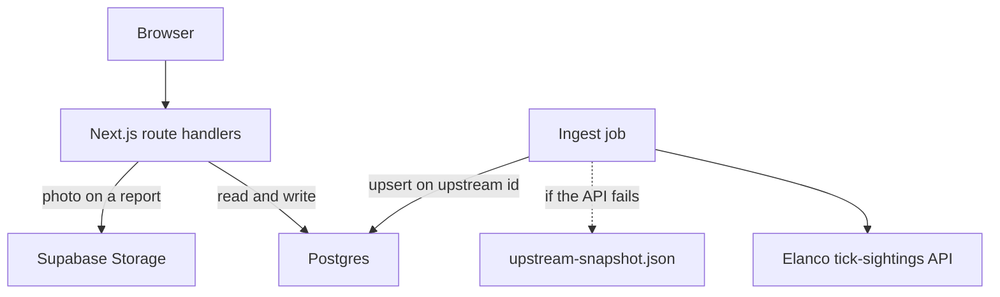

# Tick Tracker

A UK tick-sighting map, reporting form, and short guides. Built by **Anass Nadeem** for the Elanco Placement Program technical task.

**Live app:** [https://tick-tracker-elanco.vercel.app](https://tick-tracker-elanco.vercel.app)

**Demo Video** [https://youtu.be/9CfcwDCLeMg](https://youtu.be/9CfcwDCLeMg)

The longer write-up is [docs/technical-documentation.md](docs/technical-documentation.md).


## Overview

Tick Tracker shows where ticks have been reported across 14 UK cities, explains the five species in the task dataset, and accepts a new sighting. The browser reads our database. It does not call the Elanco API on each page load.

This is a placement project. It is not an official Elanco product.

## Project objectives

- Map the assigned tick-sighting dataset and keep the app usable when that API is down.
- Let someone filter the map, open a sighting, and submit their own report with validation.
- Explain the species in the feed and give practical prevention steps.
- Show seasonal activity by city and year, including a clearly labelled local extension for 2025 and 2026.

## Key features

- UK map with species encoded by shape, letter, and colour. Recent sightings carry a ring. Clusters split as you zoom.
- Filters for date, species, severity, city, and the newest 14 days in the current data.
- Sighting panel with the record, recent activity in that city, and actions to report, get directions, or share.
- Report form. Date, time, city, and species are required. Severity, a place name, a map pin, a note, and a photo are optional. A missing severity or photo warns you and still saves.
- Species guide, prevention page, and a monthly activity chart.

## Application experience


The home page: report a sighting, or open the map.


The map. Imported sightings have no coordinates, so each cluster sits on a city centre. Zooming splits a cluster into markers without asking the server again.


The report form. A pin is optional. If you do not drop one, the sighting is stored against the city centre.

## Technical architecture



One Next.js app serves the pages and the API, so there is no second service and no CORS boundary. Ingest is not part of a page load. It runs from `npm run db:setup`, from `npm run ingest`, and from `GET /api/cron/ingest` on a daily schedule.

Region and trend numbers are `GROUP BY` queries on each request. At this volume that is cheaper than maintaining summary tables.

The map loads every row that matches the current filters, then clusters those points in the browser. Zoom and pan do not refetch.

## Technology stack

| Layer | Choice |
| --- | --- |
| App | Next.js 16 (App Router), React 19, TypeScript |
| Styling | Tailwind CSS 4, one global stylesheet |
| API | Route handlers in `app/api` |
| Database | Postgres on Supabase, accessed with Prisma |
| Photos | Supabase Storage, resized with `sharp` |
| Map | Leaflet, react-leaflet, Supercluster |
| Charts | Recharts |
| Validation | Zod, shared by the form and `POST /api/sightings` |
| Data fetching | TanStack Query |
| Hosting | Vercel, with a daily cron that re-runs ingest |
| Checks | ESLint, `tsc`, and `node --test` in GitHub Actions |

## Data sources and methodology

Checked against the live API on 1 November 2026. `GET https://dev-task.elancoapps.com/data/tick-sightings` returned 1,000 records, and every record matched `data/upstream-snapshot.json`.

The feed's species names, copied unchanged into the guide:

| Common name | Latin name in the feed |
| --- | --- |
| Fox/badger tick | Ixodes canisuga |
| Marsh tick | Ixodes apronophorus |
| Passerine tick | Dermacentor frontalis |
| Southern rodent tick | Ixodes acuminatus |
| Tree-hole tick | Ixodes arboricola |

Those pairs are closed: each common name has one Latin name, and the guide does not rename either. The identification text on the species page is ours.

| Source | What it is | Years | Coordinates | Severity |
| --- | --- | --- | --- | --- |
| `upstream` | 1,000 records from the Elanco API. Each row is an id, a timestamp, one of 14 cities, a species, and a Latin name. | 3 January 2012 through 30 December 2024. 2012 is present (82 records). There is no 2025 or 2026 in the API. | None. The map uses the city-centre point stored on the city. | Set on ingest from that species' risk level in the guide. The feed itself has no severity. |
| `extended` | 150 local rows so the activity chart is not empty for the current years. Ids are prefixed `local-`. | 2025 is a full year (80 rows). 2026 is 1 January through 30 October (70 rows). Counts follow the same summer peak as the imported years. | Same as imported rows: city centre only. | Same rule: the species risk level. |
| `user_submitted` | A report from the form. | Whatever date the person enters. | City centre, unless they drop a pin. | Whatever they choose. Blank is stored as unrated. |

Pins for imported and extended rows are spread slightly around the city centre in the browser so they do not stack. That offset is not stored and it is not a field location. The sighting panel says when a point is only the city centre, and it says whether the row came from the API, the local extension, or a community report.

If the live feed is down, `npm run db:setup` and `npm run ingest` fall back to `data/upstream-snapshot.json`. Re-running ingest updates existing rows by upstream id, so it does not create duplicates.

Photos are resized to a JPEG of at most 1600px and stored in Supabase Storage. The database keeps the URL only. Without storage credentials, the same writer saves the file under `public/uploads`.

## Accessibility

- A skip link goes to the main content. Pages use one `h1`, labelled controls, and visible focus.
- Map markers are keyboard reachable. Enter opens the sighting dialog. Escape closes it.
- Species is not encoded by colour alone: each marker also has a shape and a letter, and the legend repeats them.
- The activity chart has a data table of the same numbers.
- Motion is reduced when the operating system asks for it.

## Project structure

```
app/            pages and /api routes
components/     map, report form, landing, chart
lib/            database, ingest, validation, queries
prisma/         schema and migration
tests/          checks that do not need a database
data/           offline snapshot of the upstream feed
public/images/  guide and landing photos, with attribution
docs/           technical documentation and screenshots
.github/        CI workflow
```

Working notes from the build (briefs, phase summaries, early wireframes) stay off this repository.

## Getting started

Node.js 20 or newer.

```bash
npm install
copy .env.example .env
```

On macOS or Linux, use `cp .env.example .env`.

Fill `.env` from the Supabase project:

- `DATABASE_URL` — pooled Postgres connection (port 6543)
- `DIRECT_URL` — direct connection, used by Prisma migrations (port 5432)
- `SUPABASE_URL` and `SUPABASE_SERVICE_ROLE_KEY` — photo uploads
- `SUPABASE_STORAGE_BUCKET` — `sighting-photos`
- `CRON_SECRET` — required in production before the cron route will run

Then:

```bash
npm run db:setup
npm run dev
```

Open [http://localhost:3000](http://localhost:3000).

`npm run db:setup` applies the migration and loads 14 cities, 5 species, the upstream sightings, and the 2025–2026 extension. `npm run ingest` refreshes sightings without reseeding the reference tables.

```bash
npm test
npm run lint
npm run typecheck
```

## Using the application

1. Open the map and filter by date, species, severity, or city. "Recent" keeps the newest 14 days present in the data.
2. Select a marker. The panel names the species, says whether the row is from the Elanco API or the local extension, and lists other sightings in that city.
3. Use Report a sighting for a new record. The city is required. A map pin is optional.
4. Read the species guide and the prevention page before treating a chart year as field data. 2025 and 2026 on the activity page are the local extension.

## Data handling and resilience

- Pages and the map read Postgres. A dead upstream API does not take the site down. The map shows a banner when the live health check fails.
- Ingest skips incomplete rows and unknown species or cities, and it upserts on the upstream id.
- The report endpoint validates with the same Zod schema as the form. Invalid input returns field errors. A missing optional photo or severity returns a warning and still saves.
- Uploaded images are resized before they are stored. The database stores the URL only.

## Requirements coverage

| Area | Where it lives |
| --- | --- |
| Map, markers, clustering, filters | `/map` |
| Sighting detail, city timeline, report / directions / share | Marker panel |
| Species guide, prevention, seasonal chart | `/species`, `/prevention`, `/activity` |
| Report form, shared validation, optional photo | `/report` and `POST /api/sightings` |
| Ingest, search, region totals, trends, upstream failure | `lib/ingest.ts`, `app/api` |
| Phone layout | Header menu, stacked filters, full-width form, bottom sighting panel |

Accounts, moderation, and the optional machine-learning task are not in this submission.

## Future improvements

- Replace the 2025–2026 extension if Elanco publishes those years.
- Moderate public reports before they appear on the map.
- Store a real coordinate only when a person drops a pin, which the form already does, and say so in any export.
- Page the map query again if the dataset grows well past a few thousand rows.

## Acknowledgements

- Anass Nadeem, for the Elanco Placement Program technical task.
- Elanco's dev-task API for the 1,000 sightings.
- OpenStreetMap contributors for the map tiles.
- Photo credits are listed in [public/images/ATTRIBUTION.md](public/images/ATTRIBUTION.md).

## Disclaimer

This is not an official Elanco product. Nothing in the species guide, the prevention page, or a sighting report is veterinary or medical advice. Severity on imported rows follows the species guide. It is not a clinical assessment of that sighting.
