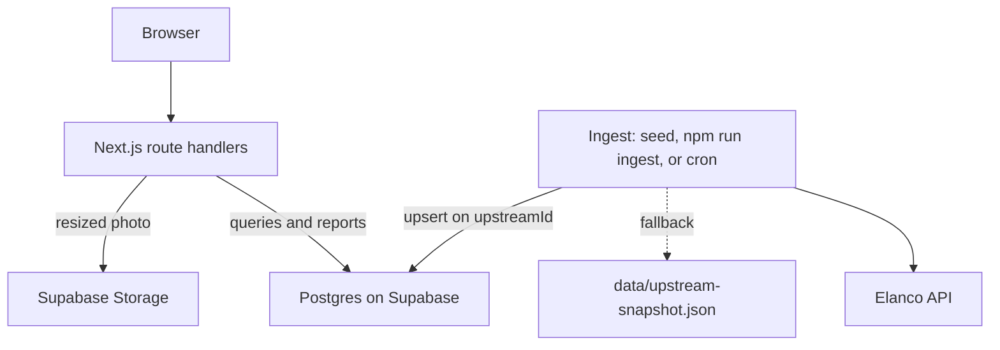
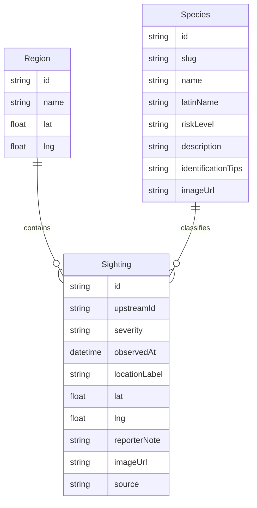

# Tick Tracker

Technical documentation

Anass Nadeem · 31 October 2026

Placement submission for the Elanco Placement Program. The running system is https://tick-tracker-elanco.vercel.app. This document describes the system as deployed: what it is, the decisions behind it, and how the data, API, interface, and components fit together.

It is a placement project shaped like a small production service. It is not an official Elanco product. The species and prevention pages are educational copy for the task. They are not veterinary or medical advice.

## 1. Introduction and overview

### 1.1 Problem

Elanco's brief asks for a UK tick-sighting tracker in the spirit of a public preventive-care map: show where ticks are being reported, help a person recognise the species in the dataset, and let them submit a sighting of their own.

The assigned brief was the frontend version. The submission is full-stack. A map and a seasonal chart are only as credible as the data behind them, so the frontend is served by an API that ingests the task feed, stores it, and accepts new reports.

### 1.2 What shipped

| Capability | What the user gets |
| --- | --- |
| Map | UK sightings, clustered, filterable by date, species, severity, city, and the newest 14 days |
| Sighting detail | Species, latin name, time, city, a plain statement when the pin is only the city centre, recent activity in that city, and actions to report, get directions, or share |
| Report | Date, time, city, and species required. Severity, place name, pin, note, and photo optional. Validation on the client and the server. Warnings do not block a valid save |
| Species guide | The five species in the dataset, ordered by risk, with a latin name and a short identification note |
| Prevention | Practical steps for people and pets, with an explicit line that the page is not a diagnosis |
| Activity | Monthly counts by city and year, as a chart and as a table of the same figures |

### 1.3 What was left out

Accounts, moderation, and the optional machine-learning insight task are not in this submission. Section 9 says what would be required before treating the service as production for a real audience.

### 1.4 Users

The primary user is a member of the public, or a reviewer, on a laptop or a phone. They do not sign in. They look at the map, read a guide, or submit one report. There is no admin role.

## 2. Decisions

Each entry is a choice that changed the shape of the system, with the reason and the cost.

### 2.1 Build full-stack against a frontend brief

The frontend is what the brief grades most closely. A mocked JSON file would have made the screens, and it would have hidden the real shape of the feed.

Choice: ingest the Elanco API into our own database and serve the UI from that database.

Cost: more of the deadline went into the pipeline and the deploy. The interface still received the depth: map, detail, form, and the three education surfaces.

### 2.2 One Next.js application

A separate Express or FastAPI service is a reasonable split with more time. It would have added a second deploy and a CORS boundary for a dataset of about a thousand rows.

Choice: App Router pages and route handlers in one project, deployed once to Vercel.

Cost: the API is tied to the Next.js process. That is acceptable at this size.

### 2.3 Design from the real payload, not the plan

The task API returns one thousand objects and nothing else. Each object has `id`, `date`, `location` (one of 14 cities), `species`, and `latinName`. There is no severity, no coordinate, no note, no image, and no pagination. The list is a bare JSON array.

Choice: keep our own species and city tables, store the upstream id for deduplication, and leave coordinates and a free-text note for reports we collect ourselves.

Cost: imported markers cannot be more precise than a city. The interface has to say that in the panel, not only in this document.

### 2.4 SQLite first, Postgres when the site was published

The first build used a local SQLite file so the project could run from a clone with one command and no account. Publishing on Vercel made that file useless: the serverless disk does not keep it.

Choice: Prisma against Supabase Postgres. `DATABASE_URL` is the pooled connection the app uses. `DIRECT_URL` is the direct connection Prisma uses for migrations. Photos moved to Supabase Storage in the same step. If the storage environment variables are unset, the writer still saves under `public/uploads`, so a local run without credentials still accepts a photo.

Cost: a reviewer who wants the live data needs the connection strings. The SQL that used SQLite `strftime` was rewritten with `date_trunc`. Row level security is enabled on the tables with no public policies. The app connects as the database owner, which bypasses those policies. The anon key is not used for table access.

### 2.5 City centres live on the city, not on the imported sighting

Choice: 14 city centroids are seeded on `Region`. Imported and extended sightings leave `lat` and `lng` null. The map uses the region centroid for those rows. A user report may store a pin on the sighting itself.

The browser spreads markers in the same city by a small hash of the row id, so the pins do not occupy one pixel. That offset is computed when the map is drawn. It is not written back.

Cost: a cluster is a city, not a park or a path. Directions open the city centre. The panel says so.

### 2.6 Severity on imported rows comes from the species guide

The feed has no severity, so a High / Medium / Low filter matched only reports typed into the form.

Choice: on ingest, set `severity` from the species risk level (`high`, `medium`, or `low`) for `upstream` and `extended` rows. A report can still omit it. Omitted severity is stored null and filtered as `unrated`.

This is not a severity recorded by the person who saw the tick. It follows the guide. A fox/badger tick in the imported set is always high, because that is the guide's risk for that species. A user report can disagree, or leave it blank.

### 2.7 2025 and 2026 are a local extension

The feed, and the snapshot taken from it, ends in 2024. The activity chart offers later years, which were empty.

Choice: after each ingest, upsert a deterministic set of rows whose `upstreamId` starts with `local-` and whose `source` is `extended`. 2025 is a full year (80 rows). 2026 is January through 30 October (70 rows). Month totals follow the summer peak of the imported years. Species and city are chosen with a stable hash so a re-run updates the same ids.

Cost: those 150 rows are not Elanco's data. They exist so the current year is not a blank chart. They are distinguishable by `source`.

### 2.8 Aggregates are computed on read

Precomputed region and trend tables would need a refresh step on every ingest.

Choice: `GET /api/stats/regions` and `GET /api/stats/trends` group in Postgres on each request. Indexes exist on `(observedAt, regionId)`, `speciesId`, and `severity`.

Cost: a dataset in the hundreds of thousands would want the precompute step. This one does not.

### 2.9 Photos are files, not columns

Choice: `sharp` rotates and resizes an upload to a JPEG at most 1600 pixels on the long side, quality 80. The object goes to the public `sighting-photos` bucket. The row stores `imageUrl`.

Accepted types are JPEG, PNG, WebP, and GIF, up to 5 MB before resizing. The database stays free of binary data.

### 2.10 The browser does not call the upstream API

Ingest runs from the seed, from `npm run ingest`, and from a daily Vercel cron (`0 6 * * *`, 06:00 UTC). The cron route requires `Authorization: Bearer $CRON_SECRET` in production. If the secret is unset in production, the route returns 401.

If the live feed fails, ingest reads `data/upstream-snapshot.json`. Incomplete records, unknown cities or species, and unparseable dates are skipped and counted. Duplicate upstream ids are upserted, not inserted twice.

`GET /api/health` checks the database and the upstream health endpoint. Upstream down is still HTTP 200 when the database is up, so the map can say the data may be stale instead of failing the page.

## 3. System architecture

### 3.1 High-level view



The browser renders the pages and calls only this application's `/api` routes. Those routes read and write Postgres. A report with a photo is validated, resized, stored, and then inserted. Ingest is a separate path. A page load never fetches the Elanco API.

### 3.2 Runtime

| Concern | How it is handled |
| --- | --- |
| Hosting | Vercel. Production URL `https://tick-tracker-elanco.vercel.app` |
| Database | Supabase Postgres in `eu-west-2`. Pooled URL for the app, direct URL for migrations |
| Object storage | Supabase bucket `sighting-photos`, public read |
| Schedule | `vercel.json` calls `GET /api/cron/ingest` daily at 06:00 UTC |
| Secrets | Environment variables. `.env` is not in the repository. `.env.example` lists the names |
| Failure of the upstream API | Ingest falls back to the snapshot. The site keeps serving the database. The map can show a stale-data banner from `/api/health` |

### 3.3 Request path for a map view

1. The map page mounts `MapScreen`.
2. The client asks `GET /api/sightings` with the current filters and the visible bounds, after a 300 ms debounce.
3. The route validates the query with Zod and returns a page of rows. The default page size is 100 and the maximum is 1000. The map asks for up to 1000 inside the current bounds.
4. Rows with no pin are drawn at the city centroid, then jittered in the client.
5. Above 200 points, Supercluster groups them. Under that threshold, markers are drawn one by one.
6. Opening a marker calls `GET /api/sightings/:id`, which returns the sighting, the latest 40 in that city, and monthly counts for the city.

### 3.4 Request path for a report

1. The form validates required fields in the browser.
2. It `POST`s `multipart/form-data` to `/api/sightings`.
3. The server parses the form, validates again with the same Zod schema, and adds warnings for a date older than 30 days, a missing severity, or a missing photo.
4. An invalid body returns 400 with field errors. A valid body is inserted even when warnings are present.
5. A photo, if present and of an allowed type, is resized and uploaded. The row stores the URL. The response is 201 with the sighting and the warnings.

### 3.5 Performance choices that are actually in the code

- Map requests include the current bounds, padded slightly so a jittered city marker is not clipped at the edge.
- Filter changes wait 300 ms. TanStack Query caches the response.
- Clustering starts at 200 points.
- Stats are grouped in SQL, not in JavaScript loops.
- The species guide and the prevention page are static. They do not query the database. The chart does.

## 4. Data design

### 4.1 Entities



| Entity | Role |
| --- | --- |
| Region | One of 14 cities. Holds the centroid used when a sighting has no pin. |
| Species | One of 5 species. Holds the latin name, the guide copy, the risk level, and the guide image. |
| Sighting | One observation. `upstreamId` is unique and is null for a report typed into the form. |

Cities: Birmingham, Bristol, Cardiff, Edinburgh, Glasgow, Leeds, Leicester, Liverpool, London, Manchester, Newcastle, Nottingham, Sheffield, Southampton.

Species and the risk used for imported severity:

| Common name | Latin name | Risk |
| --- | --- | --- |
| Fox/badger tick | Ixodes canisuga | high |
| Marsh tick | Ixodes apronophorus | medium |
| Southern rodent tick | Ixodes acuminatus | medium |
| Passerine tick | Dermacentor frontalis | low |
| Tree-hole tick | Ixodes arboricola | low |

### 4.2 Sighting fields

| Field | Imported and extended rows | User report |
| --- | --- | --- |
| `upstreamId` | Elanco id, or `local-YYYY-MM-NN` | null |
| `source` | `upstream` or `extended` | `user_submitted` |
| `observedAt` | Timestamp from the feed, stored as UTC | Date and time from the form |
| `lat`, `lng` | null | null, or the dropped pin |
| `severity` | Species risk level | `low`, `medium`, `high`, or null |
| `locationLabel`, `reporterNote`, `imageUrl` | null | Optional |

`source` is the way to tell Elanco's rows from the local extension and from a report. Volume at the time of writing is 1,000 upstream rows, 150 extended rows, plus whatever reports have been submitted on the live site.

### 4.3 Indexes

Defined on `Sighting` in the migration:

- unique `upstreamId`
- `(observedAt, regionId)` for the date and city filters and the trend query
- `speciesId`
- `severity`

### 4.4 Integrity rules

- Re-ingest upserts on `upstreamId`. The same Elanco id cannot produce two rows.
- A record is skipped if a required upstream field is missing, the city or species is not in the seed, or the date does not parse. The ingest result counts each of those.
- A report is rejected when date, time, city, or species is missing or the city and species are not in the seed. Optional fields that fail their limits are rejected with the field name.
- Warnings (old date, no severity, no photo) are returned and displayed. They do not roll back the insert.

### 4.5 What is not in the database

- The display jitter around a city centre.
- Precomputed trend or region-stat tables.
- The photo bytes.
- User accounts.

## 5. API design and routing

All routes are under `/api` on the same origin as the UI. Errors from validation are `{ errors: [{ field, message }] }`. Unexpected failures are a short `{ error }` and a 500, except ingest, which uses 502 when the job throws.

### 5.1 Routes

| Method and path | Purpose | Success | Failure |
| --- | --- | --- | --- |
| `GET /api/sightings` | Filtered, paginated list | 200 `{ data, total, page, limit, hasMore }` | 400 invalid query, 500 |
| `GET /api/sightings/:id` | One sighting, the latest 40 in that city, monthly counts for the city | 200 | 404, 500 |
| `POST /api/sightings` | Create a report. `multipart/form-data` | 201 `{ sighting, warnings }` | 400 field errors, 500 |
| `GET /api/species` | Species list for filters and the form | 200 | 500 |
| `GET /api/stats/regions` | Count and latest time per city | 200 | 500 |
| `GET /api/stats/trends` | Weekly or monthly series | 200 `{ interval, region, data }` | 400, 500 |
| `GET /api/health` | Database and a short upstream check | 200 when the database is up. Body includes `upstream: "down"` if the feed is unreachable | 503 if the database is down |
| `GET /api/cron/ingest` | Re-run ingest | 200 ingest summary | 401 if the bearer secret is missing or wrong, 502 if ingest throws |

List responses are sent with `Cache-Control: no-store`.

### 5.2 `GET /api/sightings` query

| Parameter | Rule |
| --- | --- |
| `from`, `to` | `YYYY-MM-DD` or a full timestamp. `from` must not be after `to` |
| `region` | City name |
| `species` | Species slug |
| `severity` | `low`, `medium`, `high`, or `unrated` |
| `recent` | `1` or `true`. Keeps rows within 14 days of the newest sighting in the database |
| `page` | Integer, minimum 1, default 1 |
| `limit` | Integer, 1 to 1000, default 100 |
| `north`, `south`, `east`, `west` | All four, or none. South must not exceed north. West must not exceed east |

A sighting with no pin matches the bounds when its city centroid is inside them.

### 5.3 `GET /api/stats/trends` query

| Parameter | Rule |
| --- | --- |
| `interval` | `week` or `month`. Default `month` |
| `region` | Optional city name. An unknown city is 400 |
| `from`, `to` | Same date rules as the sighting list |

### 5.4 `POST /api/sightings` fields

| Field | Rule |
| --- | --- |
| `observedDate` | Required. `YYYY-MM-DD` |
| `observedTime` | Required. `HH:MM` |
| `region` | Required. A seeded city |
| `species` | Required. A seeded slug |
| `severity` | Optional. `low`, `medium`, `high` |
| `locationLabel` | Optional. At most 160 characters |
| `reporterNote` | Optional. At most 1000 characters |
| `lat`, `lng` | Optional, and only as a pair within range. The pin must be within 40 km of the chosen city |
| `image` | Optional file. JPEG, PNG, WebP, or GIF, at most 5 MB |

### 5.5 Upstream API, for ingest only

Base URL: `https://dev-task.elancoapps.com/data`

Ingest uses `GET /tick-sightings` only. The documented city and species path filters are not used, because the full list is one response and filtering happens in Postgres. `GET /health` is used by our health route. No authentication is required on the task API. A 429 body is `{ "error": "Rate limit exceeded, please try again later" }`. Ingest retries the fetch three times, then uses the snapshot.

## 6. Interface design

### 6.1 Information architecture

| Route | Role |
| --- | --- |
| `/` | Landing. What the product is, a preview of the map, the busiest cities, and the four next steps |
| `/map` | The working map |
| `/report` | The form |
| `/species` | Identification guide |
| `/prevention` | Prevention steps |
| `/activity` | Seasonal chart |

The header carries Map, Species, Prevention, Activity, and a Report action that is present on every page. A skip link moves keyboard focus to the main content. The footer repeats the routes and states that the project is not an official Elanco service.

### 6.2 Visual language

The type is Fraunces for headings and Source Sans 3 for text. The colour is built from an Elanco blue, with a light background and white cards. The wordmark sits next to the Elanco logo. Photos on the landing page and the species guide are from Wikimedia Commons. Attribution is in `public/images/ATTRIBUTION.md`.

The interface is one stylesheet, not a component library. That was a deliberate cut for the deadline.

### 6.3 Map encoding

A marker does not rely on colour alone.

| Signal | Meaning |
| --- | --- |
| Shape and letter | Species. Diamond F, circle M, triangle P, square S, hexagon T |
| Fill colour | The same species, as a second channel |
| Border | Severity. A heavier border for high, medium, and low. A dashed border for unrated |
| Ring | The sighting falls in the newest 14 days of the points currently on the map |

The legend names the five species. Imported severity follows the species, so for those rows the border and the species move together. A user report can break that pairing by choosing a different severity or leaving it blank.

Clusters replace individual markers once more than 200 points are in the response. The cluster label is the count.

### 6.4 Sighting panel

Opened from a marker, by click or by keyboard. It is a dialog: focus is trapped, and Escape closes it and returns focus. The body shows the species, the latin name, the time, and a sentence when the coordinates are only the city centre. Below that, monthly activity and the latest sightings in the city. Another row in that list opens that sighting. Report, Get directions, and Share are the actions. Directions use the city centre when the row has no pin.

### 6.5 Report form

Empty submit shows the required-field errors and does not call the API with a body the server would reject. After a successful save, the page shows the warnings that were non-blocking and a link to the new sighting on the map. The pin control is a small map. Leaving it blank stores no coordinate.

### 6.6 Responsive behaviour and accessibility

The layout is usable at a laptop width and collapses the header, the legend, and the sighting panel for a narrow screen. The panel becomes a sheet from the bottom.

The bar I designed to, for the screens that shipped:

- A skip link, visible on focus.
- Focus styles on controls.
- Species encoded by shape and letter as well as colour.
- The sighting dialog traps focus and closes with Escape.
- Markers expose a text label to assistive technology.
- The chart has a data table of the same numbers beside it. The chart graphic is hidden from the accessibility tree so the table is the readable version.
- `prefers-reduced-motion` removes CSS animation. The chart bars do not animate.

This is not a formal WCAG audit.

### 6.7 States a reviewer should be able to reach

| State | Where |
| --- | --- |
| Empty form errors | Submit Report with nothing filled in |
| Warning, still saved | Submit a valid report with no severity and no photo |
| No results | Set a date range that matches nothing |
| Upstream unreachable | The map shows a banner when `/api/health` reports `upstream: "down"`. The markers stay, from the database |
| Load failure | The map and the chart each have an error message if their request fails |

## 7. Component design

### 7.1 Pages

| File | Responsibility |
| --- | --- |
| `app/layout.tsx` | Fonts, skip link, header, footer, React Query provider |
| `app/page.tsx` | Landing composition |
| `app/map/page.tsx` | Mounts the map screen |
| `app/report/page.tsx` | Mounts the form |
| `app/species/page.tsx` | Renders the species catalog. No database call |
| `app/prevention/page.tsx` | Static prevention content |
| `app/activity/page.tsx` | Mounts the chart |

### 7.2 Interface components

| Component | Responsibility |
| --- | --- |
| `Header`, `Footer`, `SkipLink` | Site chrome and the disclaimer |
| `landing/MapPreview`, `landing/LandingInsights` | A small map and the city totals on the home page |
| `map/MapScreen` | Filters, health banner, map, legend, and the selected panel |
| `map/FilterBar` | Controlled filters, written into the query string |
| `map/TickMap` | Leaflet map, clustering, marker selection |
| `map/Legend` | Species key, and the marker HTML used by the map |
| `map/SightingPanel` | Dialog, city timeline, report / directions / share |
| `report/ReportForm` | Client validation, multipart submit, success and error states |
| `report/PinMap` | Optional coordinate |
| `education/SeasonalChart` | City and year controls, bar chart, and the matching table |
| `useDialogBehavior` | Focus trap and Escape for the panel |
| `useDebounced` | 300 ms delay before a filter change fetches |

### 7.3 Server modules

| Module | Responsibility |
| --- | --- |
| `lib/db.ts` | Prisma client |
| `lib/ingest.ts` | Fetch or snapshot, validate, upsert, then extend |
| `lib/extend-years.ts` | The deterministic 2025 and 2026 rows |
| `lib/sightings.ts` | List query, bounds, detail, timeline |
| `lib/stats.ts` | Region totals, trends, health |
| `lib/reports.ts` | Parse the form, resize and store the photo, insert the row |
| `lib/validators.ts` | Zod schemas shared by routes and the form rules |
| `lib/report-rules.ts` | Required-field errors and non-blocking warnings |
| `lib/species-catalog.ts` | The five species, including the risk level ingest copies onto a row |
| `lib/cities.ts` | The 14 centroids |
| `lib/map-points.ts` | Choose city centre or pin, apply jitter, mark recent points |
| `lib/jitter.ts` | Stable offset from the row id |
| `lib/supabase.ts` | Storage client, only when the environment is configured |

### 7.4 How state moves

Server components render the static pages and the shells. The map, the form, and the chart are client components. They do not import Prisma. They call the route handlers. Filter state for the map lives in the URL, so a shared link reopens the same view. The selected sighting is also reflected in the URL.

The species guide reads `SPECIES_CATALOG` at build time. The same catalog is the source ingest uses for risk. The database species rows are what the filters and the form load from `GET /api/species`, seeded from that catalog. Changing a risk level means changing the catalog and re-running ingest. Existing rows pick up the new severity on the next upsert.

## 8. Deployment and operations

### 8.1 First-time setup

```bash
npm install
copy .env.example .env
npm run db:setup
npm run dev
```

`db:setup` applies `prisma/migrations` and runs `prisma/seed.ts`, which loads cities, species, and then calls the same ingest function the cron uses.

### 8.2 Production

The production project is the Vercel project `tick-tracker-elanco`. Environment variables are set in Vercel, not in the repository. A production deploy does not reseed by itself. The database was migrated and seeded once, and the cron keeps the upstream rows current.

Photos uploaded in production are in the `sighting-photos` bucket. They survive a new deploy. Local `public/uploads` files do not, which is why production does not use that path.

### 8.3 Operational limits

- There is no rate limit on `POST /api/sightings` beyond what the platform applies.
- There is no authentication. Anyone who can open the site can insert a row.
- Ingest of a changed upstream record overwrites species, city, time, and derived severity for that `upstreamId`. It does not touch a user report, because user reports have a null `upstreamId`.
- The extended rows are rewritten to the same ids on every ingest. Editing one of them by hand would be lost on the next run.

## 9. Further work

In the order I would do them if this service were going to a real audience:

1. Accounts, and a moderation state on `Sighting`, so a public report is not visible until it is accepted.
2. Automated tests for ingest (including the snapshot fallback and the dedupe), the report schema, and the filter query.
3. Rate limiting and abuse controls on the report route, and an alert when the cron returns 502 or the health check reports the database down.
4. A review of the species and prevention copy by someone clinical before it is presented as guidance.
5. If the upstream feed ever grows well past the low thousands, precomputed trend tables refreshed at the end of ingest.
6. The optional insight task from the brief. It was out of scope for this deadline. The stored columns are enough to start it without a schema change.
7. A precise coordinate, the day the source provides one. The column is already nullable and the map already prefers `Sighting.lat` and `Sighting.lng` over the city centre.

I would not add those by widening the public form first. Moderation and a test around the write path come before any new field.
